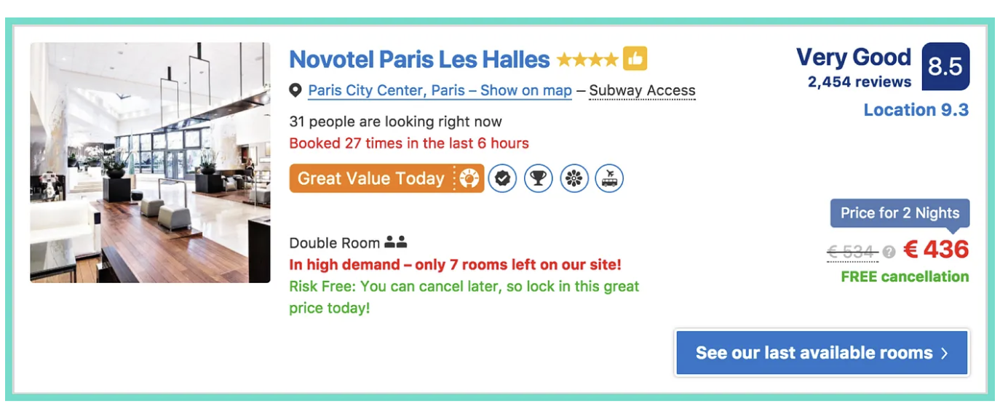
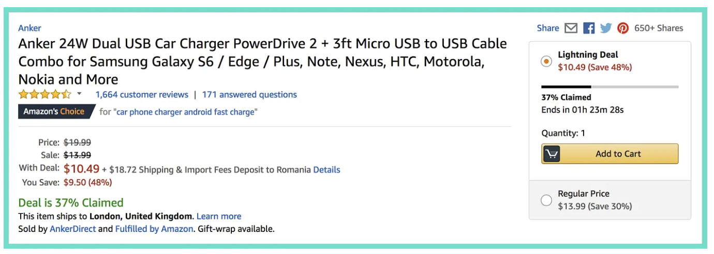
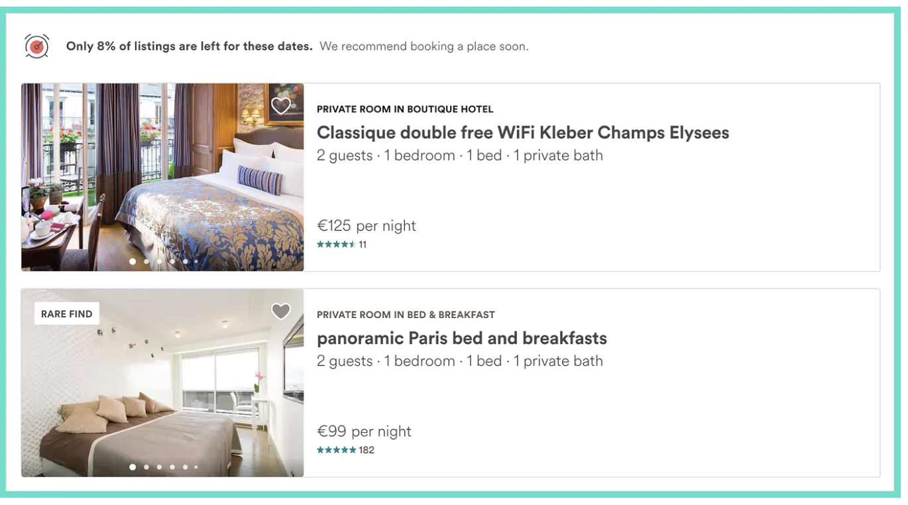

## {background-color="#f0ece4"}

```{=html}
<div class="slide-card" style="justify-content:center;">
  <div class="title-eyebrow">Marketing Psychology · 2026</div>
  <div class="title-main"><em>FOMO</em><br>Marketing</div>
  <div class="title-sub">The Psychology of Now</div>
  <div class="title-rule"></div>
  <div class="title-tags">
    <span class="tag">Consumer Psychology</span>
    <span class="tag">Behavioral Marketing</span>
    <span class="tag">Digital Strategy</span>
  </div>
</div>
```

---

## {background-color="#f0ece4"}

```{=html}
<div class="slide-card">
  <h2>What is FOMO?</h2>
  <div style="display:flex;gap:28px;flex:1;min-height:0;">
    <div style="flex:1.1;display:flex;flex-direction:column;gap:14px;justify-content:center;">
      <svg viewBox="0 0 420 108" xmlns="http://www.w3.org/2000/svg" style="width:100%;flex-shrink:0;">
        <rect x="4" y="4" width="88" height="78" rx="10" fill="#d4870a"/><polygon points="18,82 34,82 18,102" fill="#d4870a"/>
        <text x="48" y="46" text-anchor="middle" font-size="32" font-weight="700" fill="white" font-family="Cormorant Garamond,serif">F</text>
        <text x="48" y="65" text-anchor="middle" font-size="9" fill="rgba(255,255,255,.8)" font-family="Inter,sans-serif">fear</text>
        <rect x="108" y="4" width="88" height="78" rx="10" fill="#c05c28"/><polygon points="122,82 138,82 122,102" fill="#c05c28"/>
        <text x="152" y="46" text-anchor="middle" font-size="32" font-weight="700" fill="white" font-family="Cormorant Garamond,serif">O</text>
        <text x="152" y="65" text-anchor="middle" font-size="9" fill="rgba(255,255,255,.8)" font-family="Inter,sans-serif">of</text>
        <rect x="212" y="4" width="88" height="78" rx="10" fill="#a83050"/><polygon points="226,82 242,82 226,102" fill="#a83050"/>
        <text x="256" y="46" text-anchor="middle" font-size="32" font-weight="700" fill="white" font-family="Cormorant Garamond,serif">M</text>
        <text x="256" y="65" text-anchor="middle" font-size="9" fill="rgba(255,255,255,.8)" font-family="Inter,sans-serif">missing</text>
        <rect x="316" y="4" width="88" height="78" rx="10" fill="#903878"/><polygon points="330,82 346,82 330,102" fill="#903878"/>
        <text x="360" y="46" text-anchor="middle" font-size="32" font-weight="700" fill="white" font-family="Cormorant Garamond,serif">O</text>
        <text x="360" y="65" text-anchor="middle" font-size="9" fill="rgba(255,255,255,.8)" font-family="Inter,sans-serif">out</text>
      </svg>
      <div class="pull-quote">
        "The uneasy feeling that others might be having rewarding experiences from which one is absent."
        <cite>— Przybylski et al., 2013 · Motivation and Emotion Journal</cite>
      </div>
    </div>
    <div style="flex:0.85;display:flex;flex-direction:column;gap:10px;">
      <div class="stat-box" style="flex:1;"><div class="stat-num">69%</div><div class="stat-label">of millennials experience FOMO regularly</div></div>
      <div class="stat-box" style="flex:1;"><div class="stat-num">60%</div><div class="stat-label">make reactive purchases because of FOMO</div></div>
      <div class="stat-box" style="flex:1;"><div class="stat-num">33%</div><div class="stat-label">feel anxious when unable to check social media</div></div>
    </div>
  </div>
</div>
```

---

## {background-color="#f0ece4"}

```{=html}
<div class="slide-card">
  <h2>The psychology behind FOMO</h2>
  <div class="mono-label">Cognitive trigger chain</div>
  <div style="display:flex;flex-direction:column;gap:6px;flex:1;justify-content:center;">
    <div class="flow-item">
      <svg width="15" height="15" viewBox="0 0 24 24" fill="none" stroke="#c9963a" stroke-width="1.8" stroke-linecap="round" style="flex-shrink:0;"><rect x="3" y="3" width="18" height="18" rx="2"/><path d="M9 12h6M12 9v6"/></svg>
      <div><div class="flow-title">Scarcity cue</div><div class="flow-desc">People notice that something may run out soon</div></div>
    </div>
    <div class="flow-arrow">↓</div>
    <div class="flow-item">
      <svg width="15" height="15" viewBox="0 0 24 24" fill="none" stroke="#c9963a" stroke-width="1.8" stroke-linecap="round" style="flex-shrink:0;"><path d="M12 4v8M12 4l-3 4M12 4l3 4"/><circle cx="12" cy="18" r="2.5"/></svg>
      <div><div class="flow-title">Loss aversion activates</div><div class="flow-desc">People hate missing out more than they enjoy gaining something</div></div>
    </div>
    <div class="flow-arrow">↓</div>
    <div class="flow-item">
      <svg width="15" height="15" viewBox="0 0 24 24" fill="none" stroke="#c9963a" stroke-width="1.8" stroke-linecap="round" style="flex-shrink:0;"><circle cx="12" cy="12" r="9"/><path d="M9 15s1 2.5 3 2.5 3-2.5 3-2.5M10 10h.01M14 10h.01"/></svg>
      <div><div class="flow-title">Anxiety &amp; social comparison</div><div class="flow-desc">People begin comparing themselves to others and feel pressure to act</div></div>
    </div>
    <div class="flow-arrow">↓</div>
    <div class="flow-item">
      <svg width="15" height="15" viewBox="0 0 24 24" fill="none" stroke="#c9963a" stroke-width="1.8" stroke-linecap="round" style="flex-shrink:0;"><path d="M5 12h14M14 7l5 5-5 5"/></svg>
      <div><div class="flow-title" style="color:#e8b96a;">Impulse action</div><div class="flow-desc">People make quick decisions before they have time to think carefully</div></div>
    </div>
  </div>
</div>
```

---

## {background-color="#f0ece4"}

```{=html}
<div class="slide-card">
  <h2>4 FOMO triggers</h2>
  <div class="trigger-grid">
    <div class="trigger-card" style="border-top-color:#d4870a;">
      <div class="trigger-num">01 · Time scarcity</div>
      <div class="trigger-body">Countdown timers shrink the decision window, forcing fast emotional choices over deliberate ones.</div>
      <span class="trigger-example">"Offer ends in 02:47:13"</span>
    </div>
    <div class="trigger-card" style="border-top-color:#c05c28;">
      <div class="trigger-num">02 · Supply scarcity</div>
      <div class="trigger-body">Low stock signals amplify loss aversion — rarity makes inaction feel riskier than buying.</div>
      <span class="trigger-example">"Only 3 left in stock"</span>
    </div>
    <div class="trigger-card" style="border-top-color:#a83050;">
      <div class="trigger-num">03 · Social proof</div>
      <div class="trigger-body">Real-time activity creates conformity pressure and reduces perceived risk of the purchase.</div>
      <span class="trigger-example">"12 people viewing this now"</span>
    </div>
    <div class="trigger-card" style="border-top-color:#903878;">
      <div class="trigger-num">04 · Exclusivity</div>
      <div class="trigger-body">Gated access triggers status anxiety — belonging to the in-group becomes the reward itself.</div>
      <span class="trigger-example">"Members get 30-min early access"</span>
    </div>
  </div>
</div>
```

---

## {background-color="#f0ece4"}

```{=html}
<div class="slide-card">
  <h2>How brands use FOMO</h2>
  <div class="brand-row">
    <div class="brand-card">
      <div class="brand-name">Booking.com</div>
      <div class="brand-tactic">Stacks time pressure, scarcity, and social proof on every listing — making every room feel like a last chance.</div>
      
      <span class="brand-quote" style="margin-top:auto;">"Only 1 room left tonight · 24 people viewing this hotel now"</span>
    </div>
    <div class="brand-card">
      <div class="brand-name">Amazon</div>
      <div class="brand-tactic">Prime Day turned scarcity into a cultural moment. Progress bars and countdowns create a game-like urgency loop.</div>
      
      <div style="margin-top:auto;">
        <span class="brand-quote">"Lightning Deal · 73% claimed · Over 2,000 purchased today"</span>

      </div>
    </div>
    <div class="brand-card">
      <div class="brand-name">Airbnb</div>
      <div class="brand-tactic">"Rare find" badges reframe ordinary listings as exceptional — a double-sided FOMO play for hosts and guests.</div>
      
      <span class="brand-quote" style="margin-top:auto;">"Rare find · This property is usually fully booked"</span>
    </div>
  </div>
</div>
```

---

## {background-color="#f0ece4"}

```{=html}
<div class="slide-card">
  <h2>How to use FOMO ethically</h2>
  <div class="ethics-row">
    <div class="ethics-item">
      <svg class="ethics-icon" width="14" height="14" viewBox="0 0 24 24" fill="none" stroke="#c9963a" stroke-width="1.8" stroke-linecap="round"><path d="M20 6L9 17l-5-5"/></svg>
      <div class="ethics-text"><strong>Be truthful about scarcity</strong><span>If something isn’t actually limited, don’t pretend it is. Fake urgency can quickly damage customer trust.</span></div>
    </div>
    <div class="ethics-item">
      <svg class="ethics-icon" width="14" height="14" viewBox="0 0 24 24" fill="none" stroke="#c9963a" stroke-width="1.8" stroke-linecap="round"><circle cx="12" cy="12" r="3"/><path d="M12 2v3M12 19v3M4.22 4.22l2.12 2.12M17.66 17.66l2.12 2.12M2 12h3M19 12h3M4.22 19.78l2.12-2.12M17.66 6.34l2.12-2.12"/></svg>
      <div class="ethics-text"><strong>Target the already-interested</strong><span>Use FOMO with people already interested in the product instead of forcing it on everyone.</span></div>
    </div>
    <div class="ethics-item">
      <svg class="ethics-icon" width="14" height="14" viewBox="0 0 24 24" fill="none" stroke="#c9963a" stroke-width="1.8" stroke-linecap="round"><circle cx="12" cy="12" r="9"/><path d="M12 7v5l3 3"/></svg>
      <div class="ethics-text"><strong>Use sparingly — reserve for key moments</strong><span>Too much urgency stops feeling special. Save it for important launches or limited releases.</span></div>
    </div>
    <div class="ethics-item">
      <svg class="ethics-icon" width="14" height="14" viewBox="0 0 24 24" fill="none" stroke="#c9963a" stroke-width="1.8" stroke-linecap="round"><polygon points="12 2 15.09 8.26 22 9.27 17 14.14 18.18 21.02 12 17.77 5.82 21.02 7 14.14 2 9.27 8.91 8.26 12 2"/></svg>
      <div class="ethics-text"><strong>Lead with value, not fear</strong><span>Good marketing starts with a good product. FOMO should support value, not replace it.</span></div>
    </div>
  </div>
</div>
```

## {background-color="#f0ece4"}

```{=html}
<div class="slide-card">
  <h2>FOMO vs. JOMO</h2>

<div class="vs-wrap">

  <div class="vs-card">

    <div class="vs-label">FOMO</div>

    <div class="vs-title">
      Fear of Missing Out
    </div>

    <div class="vs-body">
      Driven by urgency, scarcity, and social pressure.
      Consumers rush to act because they don’t want to miss out.
    </div>

    <div class="vs-quote">
      “Buy now before it’s gone.”
    </div>

  </div>

  <div class="vs-mid">VS</div>

  <div class="vs-card">

    <div class="vs-label">JOMO</div>

    <div class="vs-title">
      Joy of Missing Out
    </div>

    <div class="vs-body">
      Focused on intentional choices and emotional balance.
      Consumers think more carefully instead of buying things impulsively.
    </div>

    <div class="vs-quote">
      “I don’t need every trend.”
    </div>

  </div>

</div>

<div class="vs-bottom">
  Modern consumers are shifting from constant urgency toward more mindful and intentional behavior.
</div>

</div>
```
---

## {background-color="#f0ece4"}

```{=html}
<div class="slide-card">

<h2>Data & Resources</h2>

<div class="references-wrap">

  <div class="reference-item">
    ThimPress. (2024).<br>
    <em>FOMO Marketing: How Fear of Missing Out Drives Consumer Behavior.</em><br>
    https://thimpress.com/fomo-marketing/
  </div>

  <div class="reference-item">
    Mailchimp. (2024).<br>
    <em>FOMO Marketing: What It Is and How to Use It Effectively.</em><br>
    https://mailchimp.com/resources/fomo-marketing/
  </div>

  <div class="reference-item">
    Booking.com, Amazon, and Airbnb interface examples used for educational analysis purposes.
  </div>

</div>

</div>
```
---

## {background-color="#f0ece4"}

```{=html}
<div class="slide-card" style="justify-content:center;">
  <div class="title-eyebrow">Thank you</div>
  <div class="title-main">Questions?</div>
  <div class="title-sub">FOMO Marketing · The Psychology of Now</div>
  <div class="title-rule"></div>
  <div class="title-tags">
    <span class="tag">Consumer Psychology</span>
    <span class="tag">Behavioral Marketing</span>
    <span class="tag">Digital Strategy</span>
  </div>
</div>
```
