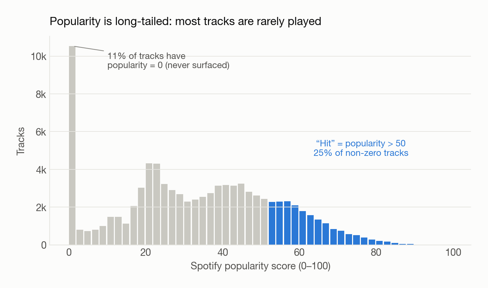
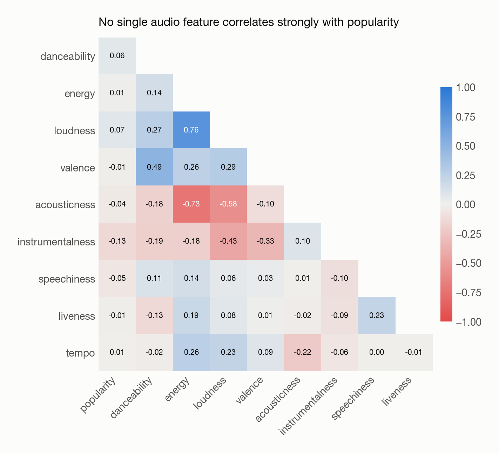
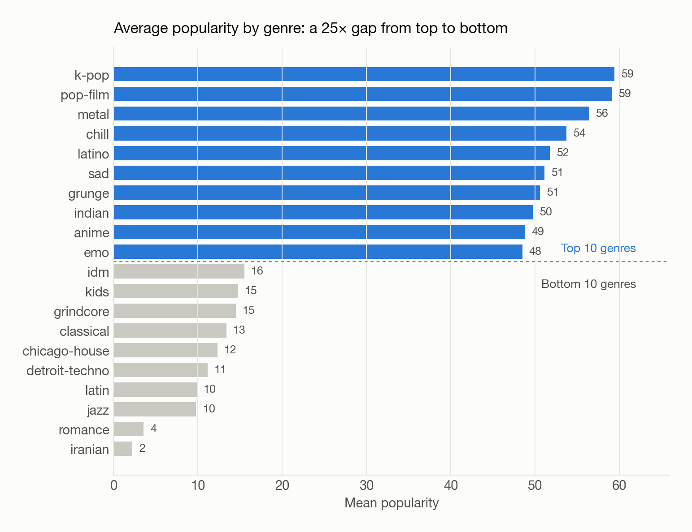
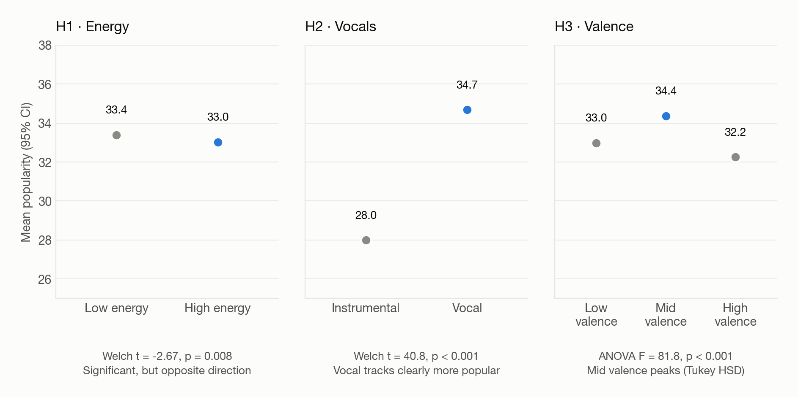
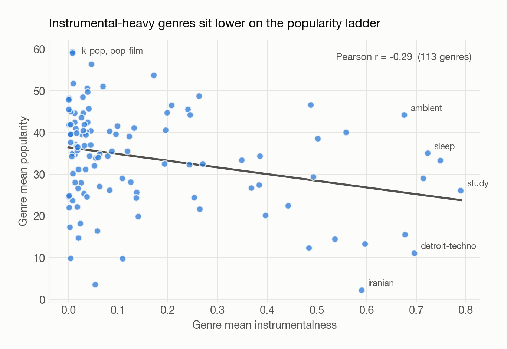
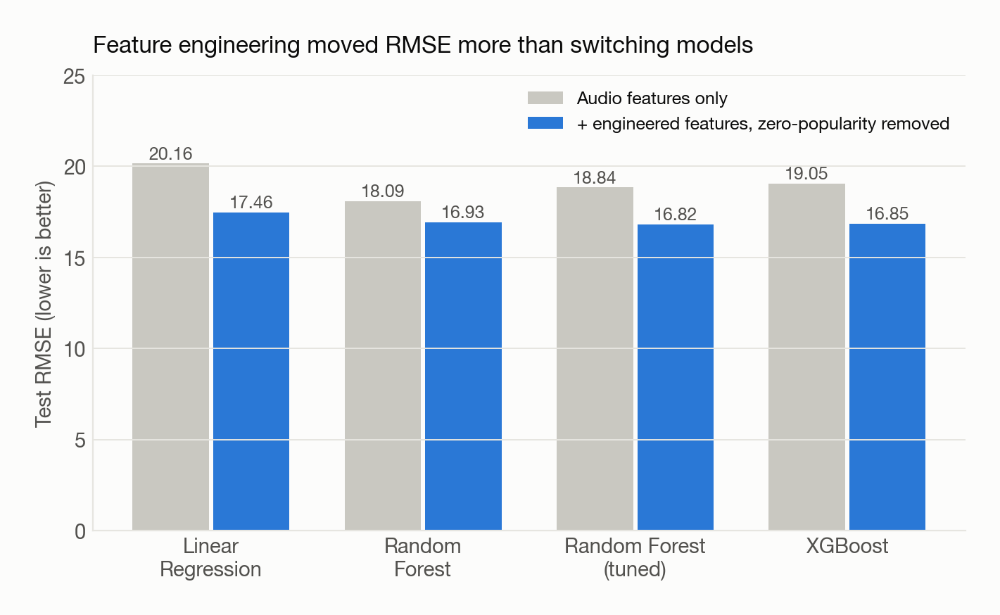
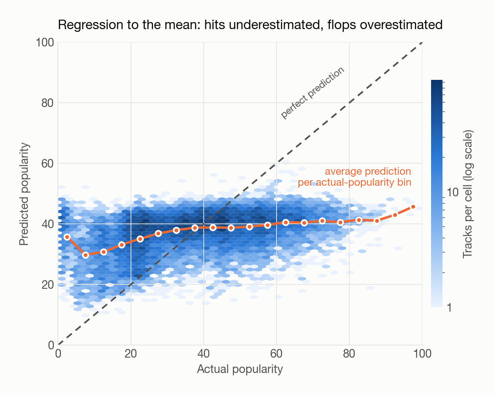
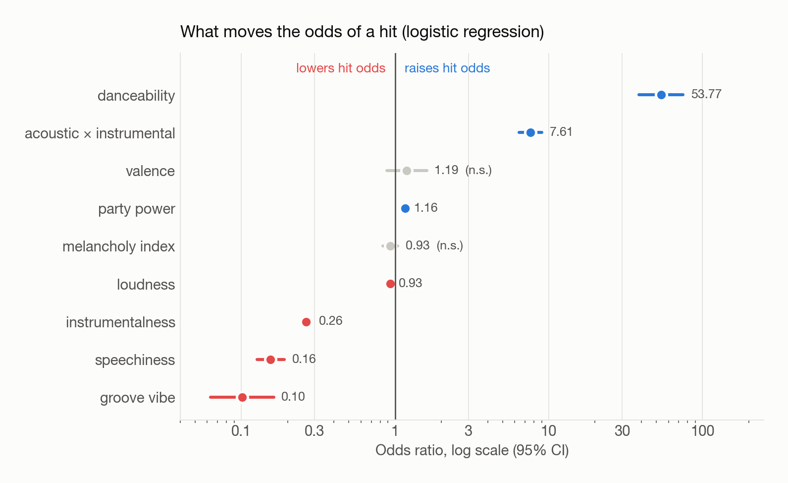
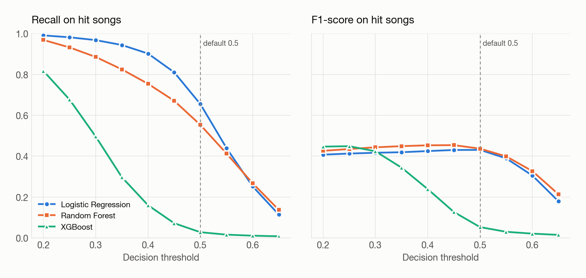

::: {.sp-hero}
[Personal project · Python]{.sp-kicker}

[If we only listen to the music itself (no artist, no marketing, no playlists), can we tell whether a song has hit potential?]{.sp-question}

::: {.sp-stats}
::: {.sp-stat}
[89.7K]{.v}
[unique tracks]{.l}
:::
::: {.sp-stat}
[113]{.v}
[genres]{.l}
:::
::: {.sp-stat}
[9]{.v}
[audio features]{.l}
:::
::: {.sp-stat}
[7]{.v}
[models compared]{.l}
:::
:::

::: {.sp-tags}
[pandas]{} [scikit-learn]{} [XGBoost]{} [statsmodels]{} [SciPy]{} [matplotlib]{}
:::
:::

## At a Glance

::: {.sp-cards}
::: {.sp-card}
[01]{.n}
[Weak single signals]{.t}

Every audio feature is statistically linked to popularity, but none explains much on its own (all |r| < 0.15).
:::
::: {.sp-card}
[02]{.n}
[Features > models]{.t}

Engineered features lowered RMSE for every model. Switching from Random Forest to XGBoost changed almost nothing.
:::
::: {.sp-card}
[03]{.n}
[Potential, not success]{.t}

Models pull every song toward the average. Audio captures whether a song *sounds* mainstream, not whether it becomes a hit.
:::
::: {.sp-card}
[04]{.n}
[Reframe the task]{.t}

Treating the problem as a hit screen (classification) is more useful than predicting exact scores (regression).
:::
:::

## The Approach

::: {.sp-pipeline}
::: {.sp-step}
**1 · Clean**
Deduplicate, handle missing values, define the hit label
:::
::: {.sp-step}
**2 · Explore**
Distributions, correlations, genre context
:::
::: {.sp-step}
**3 · Test**
Three hypotheses with t-tests, ANOVA and Tukey HSD
:::
::: {.sp-step}
**4 · Regress**
Predict the exact popularity score
:::
::: {.sp-step}
**5 · Classify**
Screen for hit vs non-hit songs
:::
:::

**Data:** [Spotify Tracks Dataset](https://www.kaggle.com/datasets/maharshipandya/-spotify-tracks-dataset) (Kaggle). It has 114K rows across 113 genres. After removing tracks listed under more than one genre, 89,740 unique tracks remain. Each track has a 0–100 popularity score and Spotify's audio features (danceability, energy, valence, acousticness, instrumentalness, speechiness, loudness, tempo, liveness).

## Exploring the Data

{fig-alt="Histogram of Spotify popularity scores with a large spike at zero and the hit region above 50 highlighted"}

Popularity has a long tail, and about **11% of tracks score exactly 0**. These are likely tracks that were never surfaced to listeners, not genuine flops, so I **excluded them from modeling**. Including them would teach the model to predict exposure rather than appeal.

::: {.panel-tabset}
### Feature correlations
{fig-alt="Correlation heatmap of audio features and popularity" width="80%" fig-align="center"}

### Popularity by genre
{fig-alt="Top and bottom 10 genres by mean popularity" width="85%" fig-align="center"}
:::

- **No single feature correlates strongly with popularity.** The largest is instrumentalness at r = −0.13.
- **Energy, loudness and acousticness move together** (r = 0.76 and −0.73), which is a multicollinearity risk for linear models.
- **Genre matters a lot.** K-pop and pop-film average around 59, while romance and iranian average under 5. Genre labels are platform categories, though, and vary widely within each genre.

## Hypothesis Testing

I tested three intuitive beliefs about what makes a song popular at α = 0.05:

{fig-alt="Mean popularity with 95% confidence intervals for energy, vocal versus instrumental, and valence groups"}

| Hypothesis | Groups | Test | Result |
|---|---|---|---|
| **H1:** High-energy songs are more popular | above vs below median energy | Welch t-test | Significant (p = 0.008), but **in the opposite direction** |
| **H2:** Vocal songs beat instrumentals | instrumentalness < 0.1 vs ≥ 0.5 | Welch t-test | **Strongly supported:** +6.7 points, t = 40.8 |
| **H3:** Happier songs are more popular | valence terciles | ANOVA + Tukey HSD | Significant, but **mid valence wins**, not high |

::: {.sp-insight}
**Statistical vs practical significance.** With ~90K tracks, even a 0.4-point gap (H1) is "significant." Only the vocal effect (H2) is large enough to matter in practice.
:::

{fig-alt="Scatter plot of genre mean instrumentalness versus genre mean popularity with a downward trend"}

The vocal advantage also shows up at the genre level. Genres with more instrumental tracks (study, sleep, detroit-techno) consistently sit lower on the popularity ladder.

## Regression: Predicting the Exact Score

### Baseline

A linear regression on raw audio features explained only **3% of the variance** (R² = 0.03). VIF checks confirmed the energy–loudness overlap, so I dropped energy from the linear model and kept it for the tree models.

### Feature engineering

Instead of just tuning models, I designed features that capture higher-level musical "moods":

```python
# center before multiplying so the interaction isn't just a scaled copy of each input
df["interaction_acoustic_instrumental"] = (
    (df["acousticness"] - df["acousticness"].mean())
    * (df["instrumentalness"] - df["instrumentalness"].mean())
)
df["melancholy_index"] = df["acousticness"] * (1 - df["valence"])   # sad + acoustic
df["party_power"]      = df["danceability"] * df["loudness"]        # club energy
df["groove_vibe"]      = df["danceability"] * df["valence"]         # upbeat groove
```

{fig-alt="Grouped bar chart of RMSE before and after feature engineering for four models"}

Feature engineering, together with removing the zero-popularity tracks, **lowered test RMSE for every model**. The tuned Random Forest was best at **16.82**. Once the features were in place, the gap between Random Forest and XGBoost was only 0.03.

### Where regression breaks down

{fig-alt="Hexbin of actual versus predicted popularity showing predictions compressed toward the middle"}

::: {.sp-insight}
**Regression to the mean.** Whatever a song's actual popularity, the model predicts roughly 30–45. Songs with 80+ popularity are underestimated by up to 60 points, and near-zero tracks are overestimated.

**Interpretation:** audio features can tell whether a song *sounds like* mainstream music. They can't see what turns that potential into plays: artist fame, playlist placement, marketing and timing.
:::

## Classification: Screening for Hits

So I **reframed the question**: instead of predicting an exact score, flag songs with hit potential (popularity > 50, about 25% of tracks). I used a stratified 80/20 split, 5-fold stratified cross-validation, and class-balanced weights.

{fig-alt="Odds ratios with confidence intervals from the logistic regression"}

The logistic regression is easy to interpret:

- **Danceability** is the strongest positive signal.
- **Speechiness** and **instrumentalness** sharply lower the odds of a hit.
- **Groove vibe** turns negative once danceability is controlled for. Upbeat-and-danceable on its own doesn't add hit potential beyond danceability.

### Model comparison

::: {.table-wrap}
| Model | Recall (hit) | Precision (hit) | F1 @ 0.5 | Best F1 (any threshold) | ROC-AUC |
|---|---|---|---|---|---|
| Logistic Regression | **0.66** | 0.32 | 0.43 | 0.43 | 0.636 |
| Random Forest | 0.55 | 0.36 | **0.44** | **0.45** | **0.669** |
| XGBoost | 0.03 | **0.64** | 0.05 | **0.45** | 0.666 |
:::

{fig-alt="Recall and F1-score versus decision threshold for three classifiers"}

::: {.sp-insight}
**The threshold matters as much as the model.** XGBoost looks broken at the default 0.5 threshold (recall 0.03) because it was trained without class weights, so its probabilities sit near the 25% base rate. At a threshold of 0.25 it matches the other models (F1 ≈ 0.45). With tuned thresholds, all three models land within 0.02 F1 of each other.
:::

**Recommendation:** use **Logistic Regression** when the goal is to catch as many potential hits as possible (high recall, fully interpretable). Use **Random Forest** when a cleaner shortlist matters more (best AUC and precision–recall balance).

## Takeaways

1. **Audio features measure *potential* popularity, not realized success.** No model can learn marketing from a waveform.
2. **Problem framing beats model complexity.** Moving from exact-score regression to a hit screen made the output more useful.
3. **Feature design beats tuning.** Domain-informed interaction features helped more than swapping in a more complex model.
4. **Always check the threshold.** A model that looks broken at the default threshold can perform well once the threshold is tuned.

## Limitations & Next Steps

- **Audio only:** add artist popularity, playlist exposure and release timing, the factors the residuals point to.
- **Hit definition:** results depend on the popularity > 50 cutoff. A ranking formulation (e.g., NDCG over shortlists) would avoid choosing a cutoff.
- **Threshold selection:** tune it on a separate validation split rather than the test set.
- **Time:** popularity is a snapshot. Modeling how songs gain or lose popularity over time would better reflect how hits actually happen.
