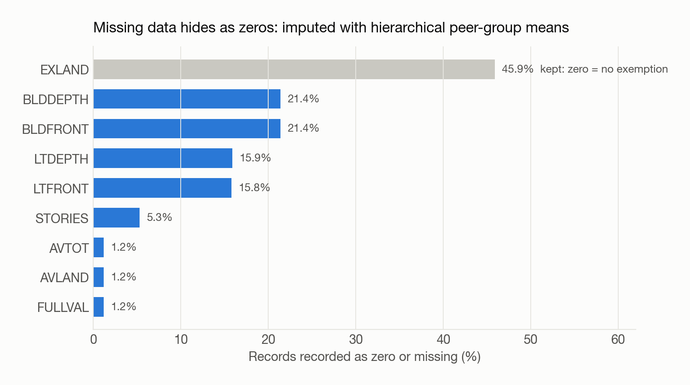
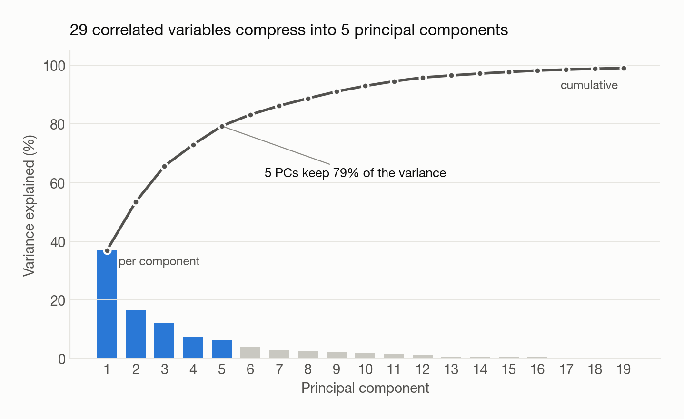
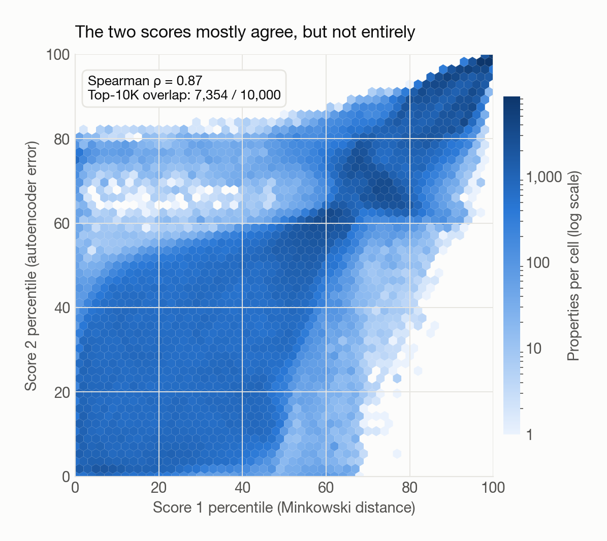
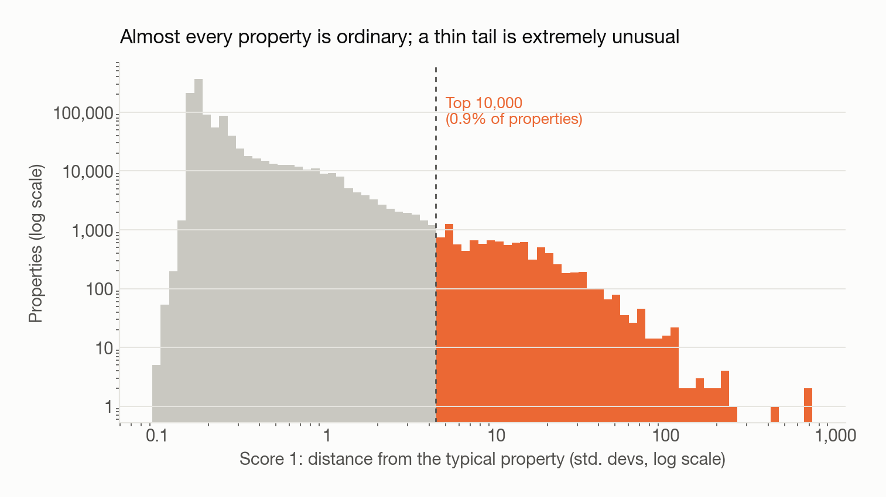
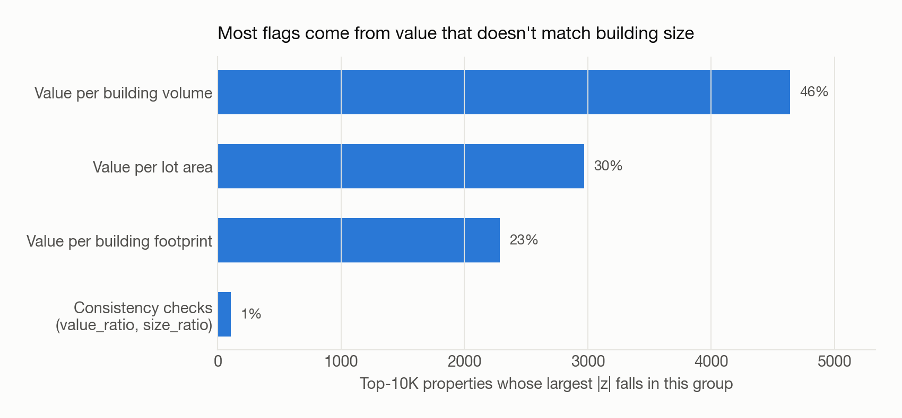
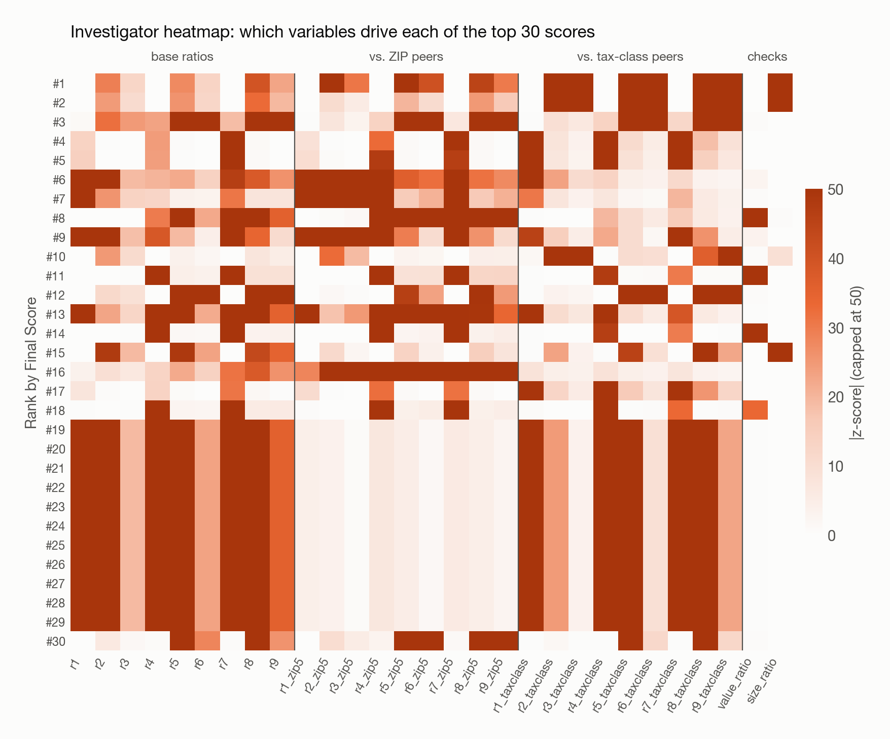

::: {.sp-hero}
[Fraud analytics · Python]{.sp-kicker}

[With no labelled fraud cases, how do you decide which of a million property records an investigator should look at first?]{.sp-question}

::: {.sp-stats}
::: {.sp-stat}
[1.07M]{.v}
[property records]{.l}
:::
::: {.sp-stat}
[29]{.v}
[engineered variables]{.l}
:::
::: {.sp-stat}
[5]{.v}
[principal components]{.l}
:::
::: {.sp-stat}
[10K]{.v}
[investigation queue]{.l}
:::
:::

::: {.sp-tags}
[pandas]{} [scikit-learn]{} [PCA]{} [Autoencoder]{} [matplotlib]{}
:::
:::

## At a Glance

::: {.sp-cards}
::: {.sp-card}
[01]{.n}
[No labels, so rank, don't predict]{.t}

There are no confirmed fraud cases to train on. The output is a ranked investigation queue, not a yes/no prediction.
:::
::: {.sp-card}
[02]{.n}
[Value should scale with size]{.t}

29 ratio variables compare each property's value with its lot, footprint and volume, relative to its ZIP code and tax-class peers.
:::
::: {.sp-card}
[03]{.n}
[Two independent detectors]{.t}

A distance score finds linear outliers and an autoencoder finds non-linear ones. Their ranks are averaged into one Final Score.
:::
::: {.sp-card}
[04]{.n}
[Built for investigators]{.t}

A heatmap shows *why* each property was flagged, and expert feedback can tighten the queue over time.
:::
:::

## The Problem

New York City's property tax depends on accurate valuations for more than a million parcels. When an owner misreports a property (lot size, number of stories, building dimensions), its assessed value can drop artificially. That lowers their tax bill and shifts the burden onto everyone else.

There is **no labelled data**: nobody has marked which records are fraudulent. So this is an **unsupervised** problem. The goal is to find the records that are most statistically unusual compared with similar properties, and pass them to human investigators in priority order.

**Data:** [NYC Property Valuation and Assessment Data](https://data.cityofnewyork.us/Housing-Development/Property-Valuation-and-Assessment-Data/rgy2-tti8) (NYC Open Data): 1,070,994 records × 32 fields across all five boroughs.

::: {.sp-pipeline}
::: {.sp-step}
**1 · Clean**
Exclude government land, impute hidden missing values
:::
::: {.sp-step}
**2 · Engineer**
29 value-to-size ratios, normalized against peers
:::
::: {.sp-step}
**3 · Reduce**
Z-scale → PCA (5 PCs) → z-scale again
:::
::: {.sp-step}
**4 · Score**
Minkowski distance + autoencoder error
:::
::: {.sp-step}
**5 · Rank**
Average the ranks; top 10K → investigators
:::
:::

## Data Cleaning

### Exclusions

Government and institutional properties follow valuation rules that aren't comparable to the private market, so they would generate false alarms. I removed:

- Government utility easements (`EASEMENT = 'U'`)
- Owners matching keywords such as *DEPT*, *GOVERNMENT*, *UNITED STATES* and *CEMETERY*, plus named entities found among the most frequent owners (City of New York, Port Authority, NYS DOT, LIRR, NYC Transit, …)

### Missing values hide as zeros

{fig-alt="Bar chart of the share of zero or missing values by field"}

A taxable parcel can't have zero frontage or be worth $0. These zeros are **missing values in disguise**, often condo units that share one building record. Dimensions and values were filled with a **hierarchical peer-group mean**: first the average for the same tax class, borough and building class, then progressively broader groups when a group was too sparse. Stories were filled with the most common value for the borough and building class.

`EXLAND` is the exception. A zero there usually means "no exemption," which is a legitimate value, so those zeros were kept. The only ones imputed were records that list an exemption code but show $0.

## Feature Engineering

**Core idea:** a bigger property should be proportionally more valuable. A property whose value doesn't match its size, in either direction, is worth a look.

| | ÷ Lot area | ÷ Building footprint | ÷ Building volume |
|---|---|---|---|
| **Full market value** | r1 | r2 | r3 |
| **Assessed land value** | r4 | r5 | r6 |
| **Assessed total value** | r7 | r8 | r9 |

Each ratio is divided by its median so that a typical property scores about 1. Then two steps make the ratios sensitive to the right things:

```python
# 1) Bidirectional: an owner who overstates lot size gets a suspiciously LOW ratio.
#    Fold both tails into one: r = 0.1 becomes 10, so both directions look extreme.
data[var] = np.maximum(data[var], 1 / (data[var] + eps))

# 2) Peer normalization: $/sq ft in Manhattan isn't suspicious; it is in Staten Island.
data[var + "_zip5"]     = data[var] / data.groupby("ZIP")[var].transform("mean")
data[var + "_taxclass"] = data[var] / data.groupby("TAXCLASS")[var].transform("mean")
```

Two **sanity-check variables** complete the set of 29:

- `value_ratio`: market value vs. assessed values. These are three valuations of the same property, so they should agree.
- `size_ratio`: building footprint ÷ lot area. Anything above 1 is physically impossible.

## Dimensionality Reduction

The 29 variables are highly correlated (r1, r4 and r7 all measure value per lot area). Without dimensionality reduction, every redundant cluster would get counted several times.

{fig-alt="Scree plot showing five principal components explain 79 percent of variance"}

1. **Z-scale** all 29 variables so that dollar-scale fields don't dominate.
2. **PCA** down to **5 components**, which keep 79% of the variance and drop the noisy tail.
3. **Z-scale again** so each component counts equally. This makes the Euclidean distance in step 4 approximate a Mahalanobis distance.

## Two Anomaly Scores

::: {layout-ncol=2}
::: {}
### Score 1 · Minkowski distance
A typical property sits near the origin of the 5-D component space. Score 1 is how far each property sits from it, measured in standard deviations.

$$s_1 = \Big(\sum_{k=1}^{5} |z_k|^{p}\Big)^{1/p},\quad p = 2$$
:::
::: {}
### Score 2 · Autoencoder error
A small neural network (5 → **3** → 5) learns to compress and rebuild normal properties. Records it can't rebuild well don't fit the learned pattern.

$$s_2 = \lVert \mathbf{z} - f(\mathbf{z}) \rVert_2$$
:::
:::

The two scores are on different scales, so each is converted to a **rank** and the ranks are averaged 50/50 into a **Final Score**.

{fig-alt="Hexbin of score 1 percentile against score 2 percentile" width="75%" fig-align="center"}

::: {.sp-insight}
**Why two detectors?** They agree on most of the extreme tail: roughly three-quarters of their top-10K lists overlap. The autoencoder also catches some properties that are only moderately far from the center but have an unusual *combination* of features, which the distance score misses.

**Robustness check:** switching the Minkowski power from p = 2 to p = 1 or p = 4 changes fewer than 4% of the top 10,000. The ranking doesn't depend on that tuning choice.
:::

## Results

{fig-alt="Log-log histogram of anomaly scores with the top 10,000 highlighted"}

The scores have an extremely long tail. Most properties sit close to their peers, while the top 10,000 (under 1% of records) sit a median of ~9 standard deviations away, and the most extreme sit hundreds away. These top records form the **investigation queue**.

{fig-alt="Bar chart of which variable group drives top-10K flags"}

Most flagged properties have a value that doesn't match their **building** size (footprint or volume), which points to misreported dimensions or story counts.

### Explaining every flag

{fig-alt="Heatmap of absolute z-scores for the top 30 properties across 29 variables"}

A score alone isn't actionable, so investigators also get this heatmap. Each row is a flagged property and each bright cell is a variable that is far from normal. The row tells the investigator *what* to check. Rows #19–29 share the same pattern: a cluster of condo units in one Manhattan building all recorded with a market value of **$18**. One data-entry error repeated across many units shows up as a block of identical rows.

### What the top of the list looks like

::: {.sp-cards}
::: {.sp-card}
[CASE A]{.n}
[Impossible geometry]{.t}

The **#1 and #2** properties are small homes in Staten Island and Queens, on 25 × 91 ft and 25 × 100 ft lots. Their recorded building footprints are **over 1,800 × 5,000 ft**, far larger than the lots they stand on.
:::
::: {.sp-card}
[CASE B]{.n}
[Valuations that disagree]{.t}

A Brooklyn vacant lot worth **$101K** should be assessed at about **$6K** for tax purposes. Its recorded assessed value is **$1**.
:::
::: {.sp-card}
[CASE C]{.n}
[Gaps in the exclusion list]{.t}

**#3 is the Metropolitan Museum of Art.** It's city-owned, but listed under "CULTURAL AFFAIRS," so the government filter missed it.
:::
::: {.sp-card}
[ACTION]{.n}
[Feedback loop]{.t}

Case C isn't fraud. It's a gap in the exclusion rules, and it's exactly the feedback the model needs. Adding owners like this to the exclusion list and re-running tightens the queue.
:::
:::

## How It Improves Over Time

The model is designed to get better as investigators review its output. In order of impact:

1. **Exclusions:** add benign categories found in review (city cultural institutions, air-rights lots, active redevelopment).
2. **Variables:** encode expert fraud hypotheses directly, e.g. exemptions relative to how long they've been held, or assessments that barely changed despite a nearby sale.
3. **Score weights:** once enough cases have been reviewed, adjust the 50/50 split toward the score that better predicts confirmed issues.
4. **Tuning parameters** (p, number of components): least important, since the ranking is robust to them.

## Tools

Python (pandas, NumPy, scikit-learn `PCA` and `MLPRegressor`, matplotlib) · NYC Open Data

*Figures on this page come from a reproducible re-run of the pipeline (random_state = 42).*
