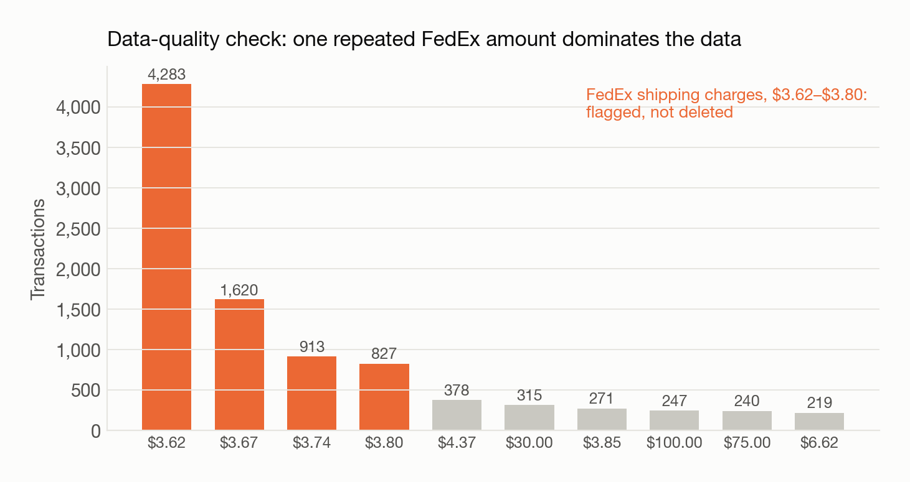
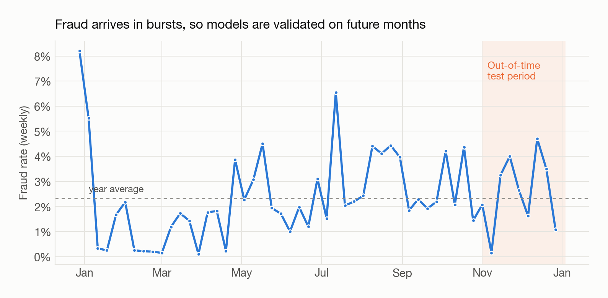
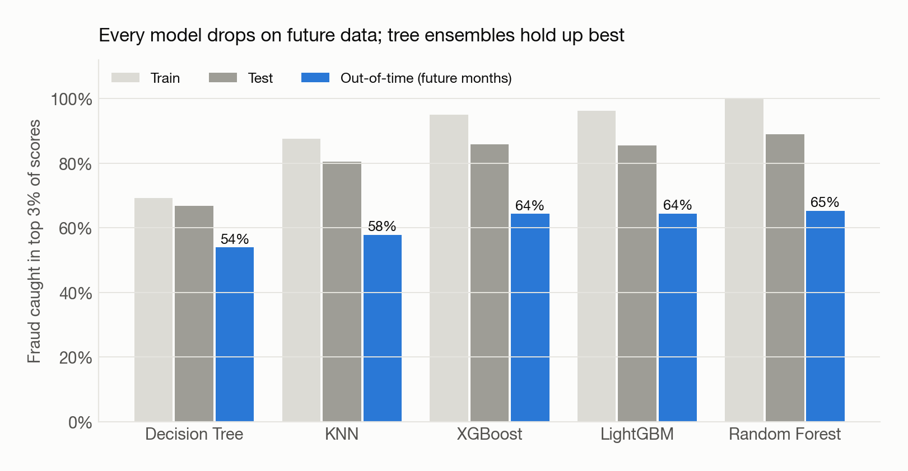
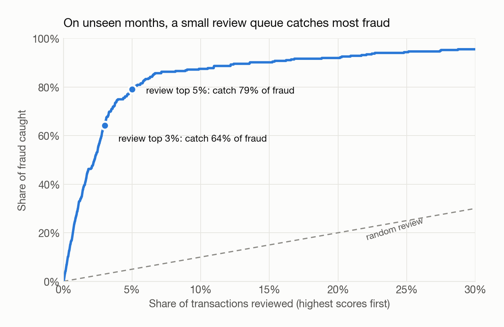
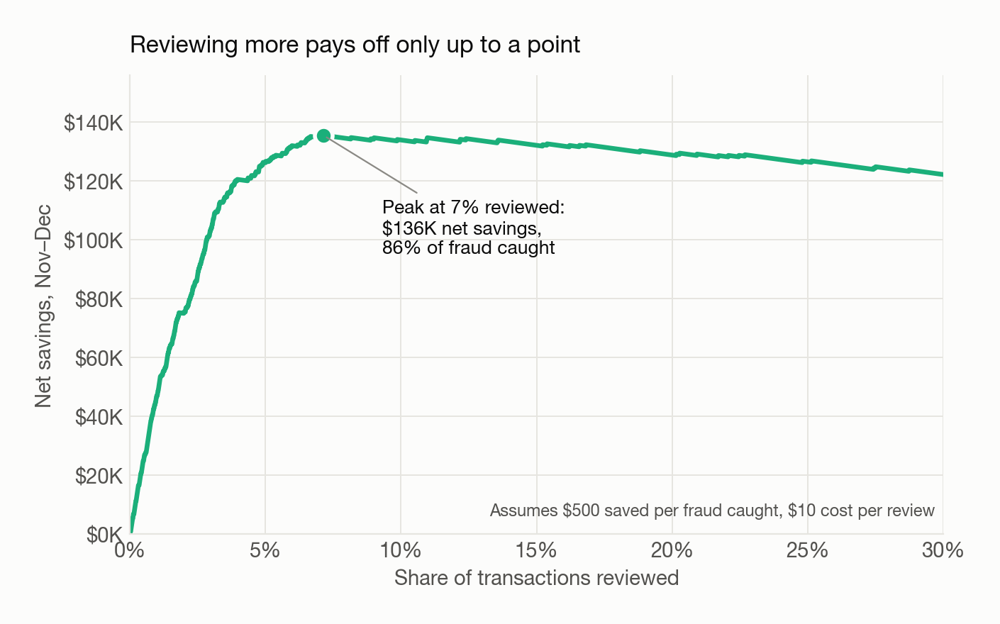
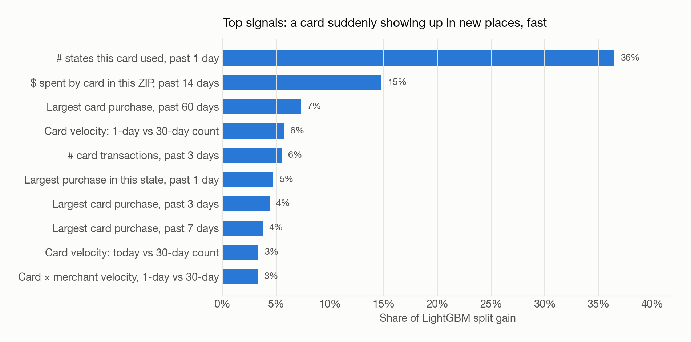

::: {.sp-hero}
[Fraud analytics · Python]{.sp-kicker}

[Which card transactions should a fraud team review today, and how many reviews are worth paying for?]{.sp-question}

::: {.sp-stats}
::: {.sp-stat}
[98K]{.v}
[card transactions]{.l}
:::
::: {.sp-stat}
[20]{.v}
[final variables, from 2,600+]{.l}
:::
::: {.sp-stat}
[5]{.v}
[models compared]{.l}
:::
::: {.sp-stat}
[79%]{.v}
[of fraud caught in top 5%]{.l}
:::
:::

::: {.sp-tags}
[pandas]{} [scikit-learn]{} [LightGBM]{} [XGBoost]{} [matplotlib]{}
:::
:::

## At a Glance

::: {.sp-cards}
::: {.sp-card}
[01]{.n}
[Behavior beats raw fields]{.t}

Fraud shows up as a card suddenly acting unlike itself, so variables compare each transaction with the card's own recent history.
:::
::: {.sp-card}
[02]{.n}
[2,600+ variables down to 20]{.t}

A KS filter followed by forward selection kept the 20 variables that best separate fraud.
:::
::: {.sp-card}
[03]{.n}
[Tested on future months]{.t}

Models are judged on November–December data they never saw, which is the honest preview of live performance.
:::
::: {.sp-card}
[04]{.n}
[Cutoff set by dollars]{.t}

The review threshold comes from a net-savings curve, not from a default 0.5 probability.
:::
:::

## The Problem

Card fraud costs issuers money and erodes customer trust. A fraud team can only review a small share of transactions, so the model's job is to **rank every transaction by risk**. The team then works down the list from the top.

This is a **supervised** problem. Each transaction is labelled fraud or legitimate, but fraud is rare (**2.3%** of 98,161 transactions), so accuracy is meaningless: a model that never flags anything is 97.7% "accurate." Performance is measured as the **fraud detection rate (FDR)**, the share of all fraud found in the top 3% or 5% of scores.

## Data & Cleaning

- Kept purchases only and removed one $3.1M record that was a data error.
- Filled missing merchant number, state and ZIP in order of reliability: look up from the same merchant's other records first, then fall back to broader rules.

{fig-alt="Bar chart of the ten most frequent transaction amounts, led by FedEx charges between 3.62 and 3.80 dollars"}

The four most common amounts in the whole dataset are FedEx shipping charges. Instead of deleting these 7,600 records, I **flagged** them so they couldn't distort amount-based variables or Benford's-law checks.

{fig-alt="Weekly fraud rate across the year with November and December shaded as the test period"}

Fraud doesn't follow transaction volume. It arrives in bursts. A random train/test split would let the model learn from days on both sides of a burst, so the last two months are held out as an **out-of-time (OOT)** test set.

## Feature Engineering

The core idea is that **fraud is a change in behavior**. A raw transaction ($84 at an office-supply store) says little on its own. What matters is how it compares with that card's recent activity.

Each variable combines three choices:

| Entity | Window | Measure |
|---|---|---|
| Card, card × merchant, card × state, card × ZIP, card × day-of-week, … | Same day, 1, 3, 7, 14, 30, 60 days | Count, total $, max $, # unique merchants / states / ZIPs, days since last use, velocity ratios |

**Velocity ratios** capture sudden bursts. For example, a card with 5 transactions today but only 6 in the past month is behaving very unusually:

```python
# today's activity relative to the card's 30-day baseline, scaled by how long it's been idle
data["Card_Merchdesc_vdratio_0by30"] = (
    count_0 / count_30 / 30) / (day_since + 1)
```

That produced **2,600+ candidate variables** (after removing duplicates).

## Feature Selection

1. **Filter:** rank every variable by its KS statistic (how well it separates fraud from legitimate on its own) and keep the top 200.
2. **Wrapper:** forward stepwise selection with a fast Random Forest, adding the variable that most improves FDR@3% at each step, until 20 remain.

I compared four wrapper runs (LightGBM, Random Forest and CatBoost; forward vs. backward). The Random Forest forward run scored best at **FDR@3% = 0.81**, and performance had already plateaued after about 6 variables. The final set is dominated by card-level counts, maximum amounts and velocity ratios.

## Model Comparison

{fig-alt="Grouped bar chart of train, test and out-of-time FDR at 3 percent for five models"}

::: {.table-wrap}
| Model | Setting | Train | Test | **Out-of-time** |
|---|---|---|---|---|
| Decision Tree | max_depth = 5 | 69% | 67% | 54% |
| KNN | k = 10 | 88% | 81% | 58% |
| XGBoost | max_depth = 4 | 95% | 86% | 64% |
| **LightGBM** | num_leaves = 16 | 96% | 86% | **64%** |
| Random Forest | 100 trees | 100% | 89% | **65%** |
:::

*FDR@3%, averaged over 5 random train/test splits.*

::: {.sp-insight}
**Why LightGBM?** The three tree ensembles are statistically tied on future data, within about 2 points of each other. Random Forest scores a perfect 100% on training data, a clear sign of memorization. LightGBM matches its out-of-time performance with less overfitting and trains much faster, which matters for retraining.

**Every model drops 13–24 points from test to out-of-time.** Fraud patterns shift over time. That's why the out-of-time number, not the test number, is the one to report.
:::

## Results

{fig-alt="Cumulative share of fraud caught versus share of transactions reviewed on out-of-time data"}

On November–December data the model never saw, reviewing the **top 3%** of transactions catches **64%** of fraud and the **top 5%** catches **79%**. Random review would catch 3% and 5%.

### Choosing the cutoff

{fig-alt="Net savings versus share of transactions reviewed, peaking around 7 percent"}

Each review costs money, so more isn't always better. Net savings peak at about **7% reviewed** ($136K over two months). Past that point, each extra review costs more than the fraud it uncovers.

::: {.sp-insight}
**Recommendation:** start at a **5% review rate**. It captures **93% of the maximum savings** with **30% fewer reviews** than the peak, leaving analyst capacity for investigating each case. Revisit the cutoff as real outcomes come in.
:::

### What the model looks for

{fig-alt="Top 10 variables by LightGBM split gain"}

The strongest signal by far is **how many different states a card was used in within one day**. A physical card rarely crosses state lines that fast, which suggests the card number is being used by someone else. Next come unusual spending in a ZIP code and sudden jumps in transaction count or purchase size.

## Next Steps

- **Real-time features:** update card behavior within the current session, not just by day.
- **Network features:** link cards and merchants that share past fraud events.
- **Cost-sensitive training:** optimize the dollar curve directly instead of FDR.
- **Monitoring:** track feature drift in production, since the test-to-OOT drop shows fraud keeps changing.

## Tools

Python (pandas, scikit-learn, LightGBM, XGBoost, matplotlib)

*Model results and figures on this page come from a reproducible re-run of the pipeline on the final 20 variables (5 random splits). Feature-selection scores are from the original analysis.*
