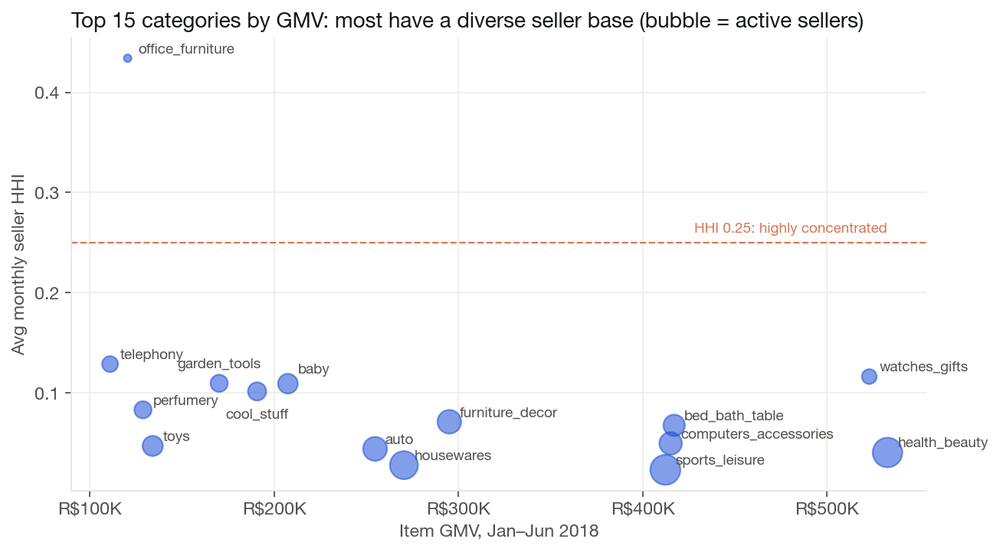

::: {.sp-hero}
[Personal project · SQL + Streamlit]{.sp-kicker}

[GMV is up, but how much of that comes from more orders and how much from bigger baskets? And which category in which state should the commercial team look at next?]{.sp-question}

::: {.sp-stats}
::: {.sp-stat}
[96K]{.v}
[delivered orders]{.l}
:::
::: {.sp-stat}
[R$13.2M]{.v}
[item GMV, 20 months]{.l}
:::
::: {.sp-stat}
[153]{.v}
[scored Category × Region pairs]{.l}
:::
::: {.sp-stat}
[0.00]{.v}
[max reconciliation gap]{.l}
:::
:::

::: {.sp-tags}
[PostgreSQL]{} [SQL · CTEs · window functions]{} [Python]{} [pandas]{} [SQLAlchemy]{} [Streamlit]{} [Plotly]{}
:::
:::

## At a Glance

::: {.sp-cards}
::: {.sp-card}
[01]{.n}
[Volume, not basket size]{.t}

Order volume explains nearly all GMV growth. Over the period it added R$802K of month-over-month change while AOV pulled back R$75K.
:::
::: {.sp-card}
[02]{.n}
[São Paulo dominates]{.t}

8 of the top 10 Category × Region opportunities are in SP, led by health_beauty (score 72.9).
:::
::: {.sp-card}
[03]{.n}
[Rankings depend on priorities]{.t}

The Growth-focused weights keep 9 of the baseline top 10. The Balanced and Delivery-focused weights keep only 5.
:::
::: {.sp-card}
[04]{.n}
[Every layer reconciles]{.t}

Row counts, key uniqueness and GMV totals were checked from raw tables through to the marts. The growth decomposition closes to the cent.
:::
:::

## The Problem

Marketplace leaders need more than a GMV line going up. They need to know **what is driving growth**, **which categories carry it**, whether supply depends on a handful of sellers, and **where to invest commercial effort next**.

I used the [Olist Brazilian E-Commerce Public Dataset](https://www.kaggle.com/datasets/olistbr/brazilian-ecommerce) (about 100K orders, 9 related tables) to answer five questions:

1. How much growth comes from order volume versus average order value (AOV)?
2. Which product categories contribute most to changes in GMV?
3. Which categories depend on too few sellers?
4. Which Category × Region combinations deserve a closer commercial look?
5. How stable is that ranking when business priorities change?

**Scope:** delivered orders, January 2017 – August 2018. The headline metric is **Item GMV**, the sum of item prices excluding freight.

## Architecture

The pipeline is built in PostgreSQL as five layers. Each layer only reads from the one before it.

::: {.sp-pipeline}
::: {.sp-step}
**Raw**

9 Olist CSVs loaded as-is into typed tables
:::
::: {.sp-step}
**Staging**

Views that clean, cast and standardize keys
:::
::: {.sp-step}
**Core**

Fact and dimension models at a fixed grain
:::
::: {.sp-step}
**Marts**

Growth, category, seller and opportunity metrics
:::
::: {.sp-step}
**Dashboard**

3-page Streamlit app on top of the marts
:::
:::

::: {.table-wrap}
| Core model | Grain |
|---|---|
| `core.fct_orders` | One row per order |
| `core.fct_order_items` | One row per order item |
| `core.dim_products` | One row per product |
| `core.dim_customers` | One row per customer record |
| `core.dim_sellers` | One row per seller |
:::

The most common way to get marketplace GMV wrong is a **one-to-many join**. An order with three items and two payments joins into six rows, which inflates the total. To prevent this, items and payments are **aggregated to the order level separately** before they are joined, and every dimension key is checked for uniqueness before it is used.

## Growth: Volume or Basket Size?

{fig-alt="Bar chart of monthly item GMV from January 2017 to August 2018 with a Black Friday spike in November 2017, plus a line chart of AOV that stays between 124 and 149 reais"}

GMV grew from R\$112K in January 2017 to a plateau of about R\$850K–980K per month in 2018. Over the same period, **AOV barely moved**: it stayed between R\$124 and R\$149 the whole time.

Because **GMV = Orders × AOV**, each month's change can be split exactly into a volume effect and an AOV effect:

```sql
-- volume effect: new orders valued at last month's AOV
(order_count - previous_orders) * previous_aov                  AS volume_effect,
-- AOV effect: change in basket size applied to this month's orders
(aov - previous_aov) * order_count                              AS aov_effect,
-- must be zero for every month
gmv_change - (volume_effect + aov_effect)                       AS reconciliation_difference
```

{fig-alt="Stacked bar chart of monthly GMV change split into order volume effect and AOV effect"}

::: {.sp-insight}
**Growth here is an acquisition story, not a basket-size story.** Across 19 comparable months, the volume effect adds up to **+R\$802K** and the AOV effect to **−R\$75K**. The biggest swings, the November 2017 Black Friday spike and the December drop that followed, are almost entirely changes in order count. To grow GMV further, the levers to test are traffic and conversion before cross-sell or pricing.
:::

## Category & Seller Health

health_beauty, watches_gifts and bed_bath_table are the three largest categories, at R\$1.0M–1.2M of GMV each over the period. Concentration is measured with the **Herfindahl-Hirschman Index (HHI)**, the sum of squared seller GMV shares. An HHI near 0 means many small sellers. An HHI of 1 means a single seller.

{fig-alt="Scatter plot of category GMV versus seller HHI for the 15 largest categories; office_furniture is the only one above 0.25"}

Most large categories have dozens to 140+ active sellers and an HHI below 0.15, so losing any one seller would not hurt them much. **office_furniture is the clear exception**: about 9 active sellers, HHI ≈ 0.43, and a top seller holding ~60% of GMV. That is a supply risk worth watching, though HHI alone does not prove one.

## Strategic Opportunity Engine

To compare growth across categories and states, every eligible **Category × Region** pair gets a transparent weighted score that compares 2018 Q2 with Q1:

::: {.table-wrap}
| Component | Weight | What it measures |
|---|---:|---|
| Growth momentum | 35% | Quarter-over-quarter GMV growth |
| Market scale | 25% | Q2 item GMV |
| Seller diversification | 20% | 1 − normalized seller HHI |
| Delivery reliability | 20% | On-time delivery rate |
:::

Each component is min-max normalized to 0–100 before weighting. To keep small samples from producing extreme growth rates, a pair is **eligible only if** it has ≥ 20 orders in both quarters, ≥ 3 active sellers in Q2, ≥ 20 orders with usable delivery dates, and ≥ 80% delivery-data coverage. **153 pairs** pass.

{fig-alt="Stacked horizontal bars showing how growth, scale, diversification and delivery contribute to each of the top 10 opportunity scores"}

Breaking each score into its components makes the ranking explainable. There are two kinds of top opportunity:

- **Scaled, steady leaders** such as health_beauty, bed_bath_table and watches_gifts in SP. They score on market size and a diversified seller base.
- **Fast-growing niches** such as books_general_interest in SP and electronics in SC. Almost all of their score is growth momentum, from a small base.

These two groups call for different actions: defend and deepen the leaders, and validate the niches before investing.

### How stable is the ranking?

The weights are an analyst's choice, so I re-ranked all 153 pairs under three other weighting schemes and tracked where the baseline top 10 ended up.

{fig-alt="Grid showing the rank of each baseline top-10 opportunity under Baseline, Growth-focused, Balanced and Delivery-focused weightings"}

::: {.sp-insight}
**The top 4 are robust. The rest depend on priorities.** health_beauty, bed_bath_table, watches_gifts and housewares in SP stay in the top 10 under every scenario. The growth-driven niches are fragile: books_general_interest in SP falls from **#6 to #47** once growth is weighted equally with the other components. **Recommendation:** treat the top 4 as a high-confidence shortlist, and agree on the business priority (growth versus reliability) before acting on positions 5–10.
:::

## Data Quality & Validation

Every layer has its own validation SQL (`07_validate_growth_marts.sql`, `10_validate_opportunity_engine.sql`, `14_validate_sensitivity.sql`):

::: {.table-wrap}
| Check | Result |
|---|---|
| Raw → staging → core row counts | Match |
| Key uniqueness (orders, items, products, dimensions) | No duplicates |
| Item GMV: raw = core = base mart = monthly = category = region | All totals match |
| Month coverage | All 20 months present |
| Growth decomposition: volume + AOV = GMV change | Max difference 0.000000 |
| Opportunity scores in 0–100, no duplicate pairs, no threshold violations | 0 failures |
:::

## Performance Tuning

The first version of the opportunity ranking query ran for **more than 10 minutes**: one statement with nested joins, `COUNT(DISTINCT …)` and window functions over the full item table. I fixed it by:

- Simplifying the staging orders view once uniqueness checks showed the extra de-duplication logic was unnecessary.
- **Materializing** the shared item-level base (`marts.mv_base_growth_items`) and the opportunity scores, and adding supporting indexes.
- Reusing the precomputed scores for the sensitivity analysis instead of recomputing each scenario from raw data.

After these changes, the ranking and all sensitivity scenarios return quickly enough to power the dashboard interactively.

## Dashboard

A three-page **Streamlit** app reads directly from the marts:

1. **Growth Overview:** monthly KPIs, GMV, order and AOV trends, and the volume vs. AOV decomposition.
2. **Category & Seller Health:** category GMV and growth contribution, active sellers, HHI and top-seller share.
3. **Opportunity Explorer:** pick a weighting strategy, browse the ranked pairs with score explanations, check ranking stability and export to CSV.

## Limitations

- The data is historical (2017–2018) and does not describe today's market.
- Item GMV excludes freight, discounts and returns. It is not revenue or profit.
- Filtering to delivered orders can bias recent months, where some orders had not been delivered yet.
- Weights and eligibility thresholds are analyst-defined. The scores are relative priorities, not forecasts or causal estimates.

## Next Steps

- Let users set their own scoring weights in the dashboard, and test sensitivity to the eligibility thresholds as well.
- Automated data-quality tests (e.g. dbt tests) in place of hand-run validation queries.
- Formal before/after query benchmarks for the performance work.
- A hosted demo backed by a small cloud Postgres instance.

## Tools

PostgreSQL (CTEs, window functions, views, materialized views, indexes) · Python (pandas, SQLAlchemy, psycopg) · Streamlit · Plotly

<!-- TODO: add the GitHub link once the repo is pushed, e.g.
[View the code on GitHub](https://github.com/<username>/<repo>){.btn .btn-outline-primary}
-->

*Figures on this page come from the project's PostgreSQL marts. This is an independent portfolio project and is not affiliated with Olist.*
